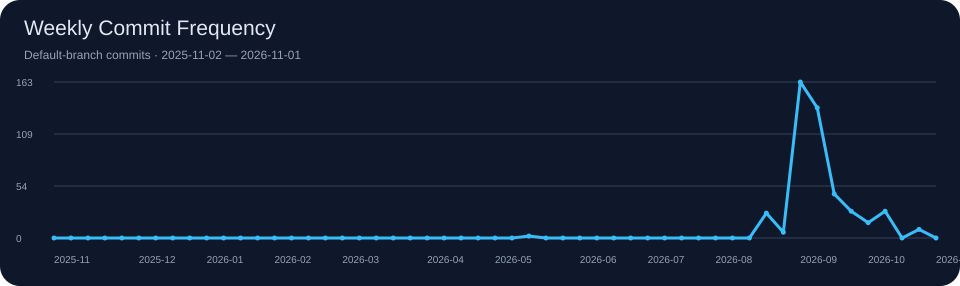

# 你好，我是 Luskyle 👋

> 渺万里层云，千山暮雪。

欢迎来到我的 GitHub 主页！这里记录我的开源项目、开发工具与探索过程。

[个人主页](https://github.com/luskyle) · [所有仓库](https://github.com/luskyle?tab=repositories) · [精选项目](#-精选项目) · [统计图表](#-github-统计图表)

<!-- ABOUT:START -->
- **关注方向：** 工控 / 上位机开发素材、开发工具与浏览器扩展
- **正在做：** 维护下方列出的公开项目；具体计划待补充。
- **正在学：** 待补充（不根据仓库语言推断学习计划）。
<!-- ABOUT:END -->

## 🌟 精选项目

<!-- FEATURED:START -->
跟随 GitHub 主页置顶仓库，按置顶顺序展示。

### [luskyle/kicad-mcp](https://github.com/luskyle/kicad-mcp)

这是一个带 kicad-mcp 的 KiCad 源码仓库：在标准 KiCad 之上，增加了 MCP（Model Context Protocol）能力 —— 让 AI 助手通过自然语言直接控制 KiCad 绘制/检查/仿真原理图与 PCB，实现"你说电路，AI 画图"。

**C++** · ⭐ 0 · Forks 0

### [luskyle/pupu](https://github.com/luskyle/pupu)

一款多平台内容发布浏览器扩展，一次编辑，轻松将内容同步发布到多个社交平台。

**TypeScript** · ⭐ 0 · Forks 1

### [luskyle/menuconfig-plusplus](https://github.com/luskyle/menuconfig-plusplus)

从 linux kernel 源码中的 mconf 工具优化改造而来。用于图形化生成项目宏配置。

**C** · ⭐ 0 · Forks 0

### [luskyle/antelope](https://github.com/luskyle/antelope)

小巧敏捷的 C/C++ 编译链接工具。用一份或多份 JSON 配置描述构建目标，把项目编成静态库、共享库或可执行程序；不生成 makefile，也不引入额外的构建语言。最重要的是，你可以与cmake说拜拜了

**Python** · ⭐ 0 · Forks 0

### [luskyle/moz](https://github.com/luskyle/moz)

暂未填写仓库简介。

**C++** · ⭐ 0 · Forks 0

### [luskyle/the-world](https://github.com/luskyle/the-world)

认识这个世界

**CSS** · ⭐ 0 · Forks 0
<!-- FEATURED:END -->

## 🔨 最近维护

<!-- RECENT:START -->
- **[luskyle](https://github.com/luskyle/luskyle)** · 最近推送 2026-11-01
  暂未填写仓库简介。
- **[fake-lingxi](https://github.com/luskyle/fake-lingxi)** · 最近推送 2026-10-30
  暂未填写仓库简介。
- **[damn-clock-in](https://github.com/luskyle/damn-clock-in)** · 最近推送 2026-10-29
  暂未填写仓库简介。
<!-- RECENT:END -->

## 📦 最新发布

<!-- RELEASES:START -->
- 2026-10-10 · **pupu** · [v0.3.0](https://github.com/luskyle/pupu/releases/tag/v0.3.0)
- 2026-10-09 · **antelope** · [v1.4](https://github.com/luskyle/antelope/releases/tag/v1.4)
- 2026-10-08 · **antelope** · [v1.3](https://github.com/luskyle/antelope/releases/tag/v1.3)
- 2026-09-29 · **moz** · [vscode-dxf-viewer-v0.2.4](https://github.com/luskyle/moz/releases/tag/vscode-dxf-viewer-v0.2.4)
- 2026-09-29 · **moz** · [vscode-dxf-viewer-v0.2.3](https://github.com/luskyle/moz/releases/tag/vscode-dxf-viewer-v0.2.3)
<!-- RELEASES:END -->

## 📊 GitHub 统计图表

<!-- PROFILE:START -->
| 公开仓库 | Followers | Following | 原创仓库 Stars |
| ---: | ---: | ---: | ---: |
| 41 | 10 | 4 | 31 |
<!-- PROFILE:END -->

### 📈 每周提交频率

<!-- COMMITS:START -->

<!-- COMMITS:END -->

## 🐍 贡献蛇动画

<!-- CONTRIBUTIONS:START -->

<!-- CONTRIBUTIONS:END -->

## 🚀 热门原创仓库

<!-- REPOSITORIES:START -->
| 仓库 | 简介 | 语言 | Stars |
| --- | --- | --- | ---: |
| [Solutions](https://github.com/luskyle/Solutions) | 面向工控 / 上位机桌面软件开发的专题集与素材库（2017 年起积累）。 | — | 13 |
| [luskyle](https://github.com/luskyle/luskyle) | — | JavaScript | 0 |
| [fake-lingxi](https://github.com/luskyle/fake-lingxi) | — | — | 0 |
| [damn-clock-in](https://github.com/luskyle/damn-clock-in) | — | Kotlin | 0 |
| [the-world](https://github.com/luskyle/the-world) | 认识这个世界 | CSS | 0 |
| [litedroid](https://github.com/luskyle/litedroid) | — | Shell | 0 |
<!-- REPOSITORIES:END -->

## 📬 联系我

<!-- CONTACT:START -->
[GitHub · luskyle](https://github.com/luskyle) · [公开邮箱](mailto:844804539%40qq.com)
<!-- CONTACT:END -->

---

文字与统计图每 6 小时自动刷新，也支持手动更新。图片由本仓库生成，无第三方统计图片服务。
动态区域外的文字可以自由编辑；个人方向可通过配置文件调整。
配置与部署方法见 [自动更新说明](./docs/automation.md)。

<!-- DOCUMENT_UPDATED:START -->
文档更新时间：2026-11-01（UTC）
<!-- DOCUMENT_UPDATED:END -->
